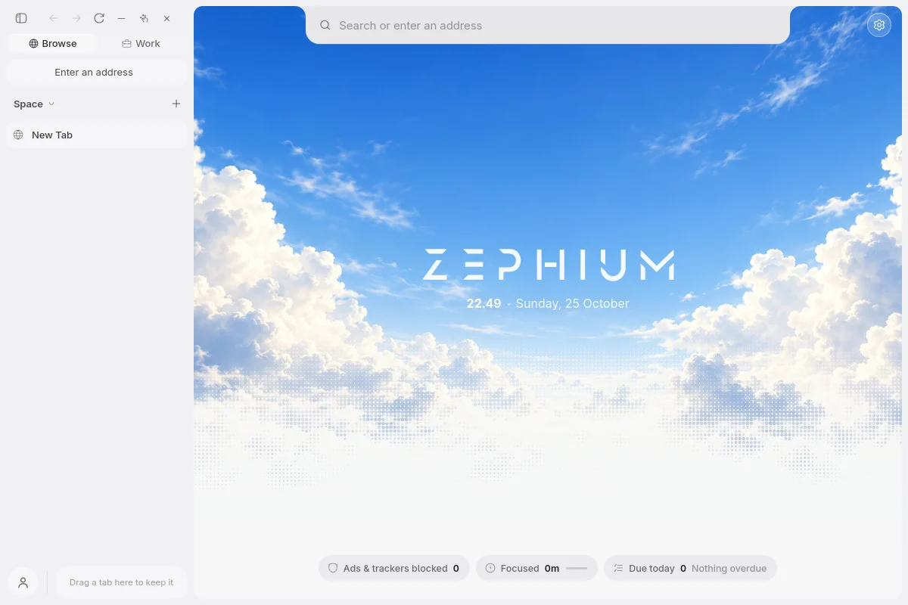
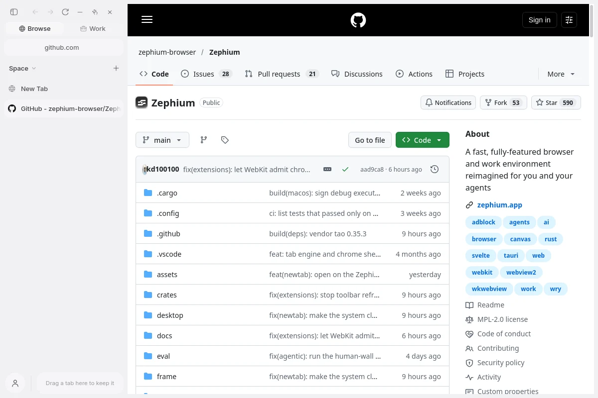

<div align="center">
  
  <h1>Zephium-Linux</h1>
  <p><strong>The Zephium browser, ported to Linux.</strong><br />
  Arch Linux and CachyOS, on WebKitGTK, following upstream's main within the hour.</p>
</div>

<p align="center">
  
</p>

[Zephium](https://github.com/zephium-browser/Zephium) is a browser built in
Rust on the operating system's own web engine. Upstream ships it for macOS
and Windows. Its source already holds most of a WebKitGTK port, switched off.
This fork switches it on, fixes what stopped it drawing on Linux, and keeps
the result current with upstream.

This is an unofficial port, not affiliated with the Zephium project. Report
Linux problems here; everything else belongs
[upstream](https://github.com/zephium-browser/Zephium/issues).

## What works

| | |
| --- | --- |
| Browsing, tabs, the sidebar, the new tab, back and forward | yes |
| Ad and tracker blocking (adblock-rust, EasyList, EasyPrivacy) | yes; the new tab's counter stays at 0 |
| Keyboard shortcuts, links opened from other apps | yes |
| Wayland | yes, tested on sway; Hyprland and X11 not yet confirmed |
| Work and Ask Zephium reading or driving pages | not yet: upstream has no WebKitGTK agent browser |
| Chrome and Firefox extensions | in progress: the port brings its own runtime, since WebKitGTK has none ([plan](../linux/docs/extensions.md)) |
| Keychain for AI keys | not yet: no Linux side upstream |

<p align="center">
  
</p>

## Install

Needs `webkit2gtk-4.1` 2.54.0 or newer. Zephium refuses older ones, because
they lack the fixes in
[WSA-2026-0006](https://webkitgtk.org/security/WSA-2026-0006.html). Run a full
`sudo pacman -Syu` first.

**Kept up to date** (recommended). Nothing is compiled on your machine:

```sh
sudo pacman -S --needed git github-cli webkit2gtk-4.1 libarchive grim python
gh auth login    # GitHub serves workflow builds only to signed-in users
git clone https://github.com/vermingov/Zephium-Linux.git
cd Zephium-Linux/linux && ./install.sh
```

`install.sh` puts `zephium-linux` on your PATH and adds a systemd user timer.
Every hour it fetches the newest build of `main` that passed this fork's
workflow, checks it against the digest GitHub recorded, starts it on a hidden
headless desktop, and only then replaces the installed one. It never installs
a build on older upstream code than the one you have. The browser is
`zephium`, and Zephium in your app launcher. `zephium-linux status` says what
is installed; `zephium-linux rollback` goes back one version.

**By hand**: open the newest successful run of the
[Linux workflow](https://github.com/vermingov/Zephium-Linux/actions/workflows/linux.yml?query=branch%3Amain+event%3Apush),
download its `zephium-linux-deb` artifact, and unpack the `.deb` with
`bsdtar`; the browser is `usr/bin/zephium-desktop` inside it.

## How the port is kept

`main` is the only branch: upstream's newest `main`, then the port's
commits, then one commit with this page, the workflow and
[`linux/`](../linux), the update tooling. Every hour the fork's
[workflow](workflows/linux.yml) replays the port onto upstream's newest
commit, runs upstream's own guard tests and the port's, builds the `.deb`,
and pushes `main` only if all of that passed. If a port commit stops
applying, that run fails and `main` stays on the last good build until the
commit is carried over by hand. Installs made with `zephium-linux` take only
builds that passed.

| Commit | Why |
| --- | --- |
| `build(linux): stop refusing to build and start on Linux` | Upstream's build script and `run()` both exit on Linux. |
| `build(linux): link the Work stack and shortcut types on Linux` | Two crates the shared code names were linked on macOS and Windows only. |
| `fix(engine): compile agentic-browser on Linux` | A few native agent-browser calls had no Linux fallback. |
| `fix(linux): size the chrome view when the window maps at its requested size` | On compositors that map a window at exactly the size it asked for (sway, Hyprland), the browser chrome stayed 1×1 pixels and the window drew nothing. |
| `feat(linux): web-process plugin as the extension channel` | WebKitGTK has no extension runtime, and upstream keeps its raw isolated-world handler out of product builds. A web-process plugin gives each extension's world one bounded, read-only way to the browser ([why](../linux/docs/extensions.md)). |
| `feat(linux): load the extension channel into profiles' web processes` | Loads that plugin into each profile's web processes and checks every message again in the browser. |

When upstream publishes its own Linux build, installs made with
`zephium-linux` switch to it. It is checked against upstream's updater
signing key, and this port stops being built.

## License

Zephium is © the Zephium authors, under the
[Mozilla Public License 2.0](../LICENSE). The port and its tooling are under
the same license.
