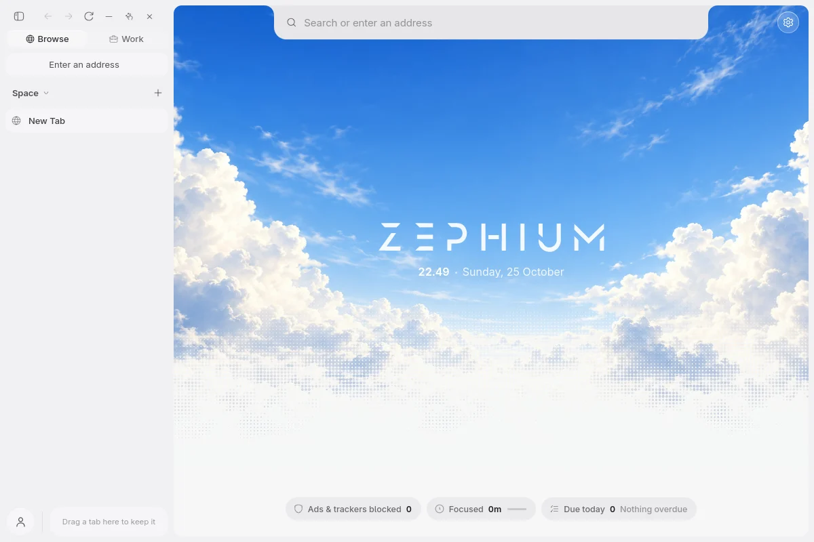
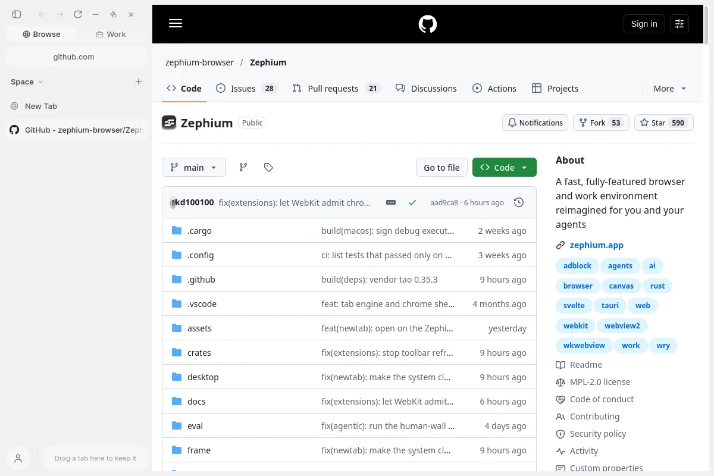

<div align="center">
  
  <h1>Zephium-Linux</h1>
  <p><strong>The Zephium browser, ported to Linux.</strong><br />
  Arch Linux and CachyOS, on WebKitGTK, rebuilt from every upstream release.</p>
</div>

<p align="center">
  
</p>

[Zephium](https://github.com/zephium-browser/Zephium) is a browser built in
Rust on the operating system's own web engine. Upstream ships it for macOS
and Windows. Its source already holds most of a WebKitGTK port, switched off.
This fork switches it on, fixes what stopped it drawing on Linux, and keeps
the result current with upstream.

This is an unofficial port, not affiliated with the Zephium project. Report
Linux problems here; everything else belongs
[upstream](https://github.com/zephium-browser/Zephium/issues).

## What works

| | |
| --- | --- |
| Browsing, tabs, the sidebar, the new tab, back and forward | yes |
| Ad and tracker blocking (adblock-rust, EasyList, EasyPrivacy) | yes; the new tab's counter stays at 0 |
| Keyboard shortcuts, links opened from other apps | yes |
| Wayland | yes, tested on sway; Hyprland and X11 not yet confirmed |
| Work and Ask Zephium reading or driving pages | not yet: upstream has no WebKitGTK agent browser |
| Chrome extensions, keychain for AI keys | not yet: no Linux side upstream |

<p align="center">
  
</p>

## Install

Needs `webkit2gtk-4.1` 2.54.0 or newer. Zephium refuses older ones, because
they lack the fixes in
[WSA-2026-0006](https://webkitgtk.org/security/WSA-2026-0006.html). Run a full
`sudo pacman -Syu` first.

**Built here, kept up to date** (recommended):

```sh
sudo pacman -S --needed git rustup base-devel webkit2gtk-4.1 libarchive grim python
git clone https://github.com/vermingov/Zephium-Linux.git
cd Zephium-Linux/linux && ./install.sh
```

`install.sh` puts `zephium-linux` on your PATH, adds a systemd user timer and
builds the current release (about 20 minutes the first time). The browser is
then `zephium`, and Zephium in your app launcher. Every six hours the timer
checks upstream. When a new release is out, it rebuilds, starts the build on
a hidden headless desktop, and only then replaces the installed one.
`zephium-linux status` says what is installed; `zephium-linux rollback` goes back one version.

**Prebuilt** (x86_64, Arch and CachyOS): download the archive from
[Releases](https://github.com/vermingov/Zephium-Linux/releases), then

```sh
mkdir -p ~/.local/opt/zephium && tar -xzf Zephium-Linux-*.tar.gz -C ~/.local/opt/zephium
~/.local/opt/zephium/*/zephium
```

## How the port is kept

The `linux` branch is upstream's latest release, then the port as four
commits, then one commit with this page and [`linux/`](../linux), the build
and update tooling. On each upstream release the port commits are replayed
onto the new code and the branch is pushed again; every published build is
also tagged (`v1.0.3-linux.1`). If a commit stops applying, Claude Code gets
one attempt to carry it over. The result has to compile, build and start
before anything is installed or published. `main` follows upstream untouched.

| Commit | Why |
| --- | --- |
| `build(linux): stop refusing to build and start on Linux` | Upstream's build script and `run()` both exit on Linux. |
| `build(linux): link the Work stack and shortcut types on Linux` | Two crates the shared code names were linked on macOS and Windows only. |
| `fix(engine): compile agentic-browser on Linux` | A few native agent-browser calls had no Linux fallback. |
| `fix(linux): size the chrome view when the window maps at its requested size` | On compositors that map a window at exactly the size it asked for (sway, Hyprland), the browser chrome stayed 1×1 pixels and the window drew nothing. |

When upstream publishes its own Linux build, installs made with
`zephium-linux` switch to it. It is checked against upstream's updater
signing key, and this port stops being built.

## License

Zephium is © the Zephium authors, under the
[Mozilla Public License 2.0](../LICENSE). The port and its tooling are under
the same license.
